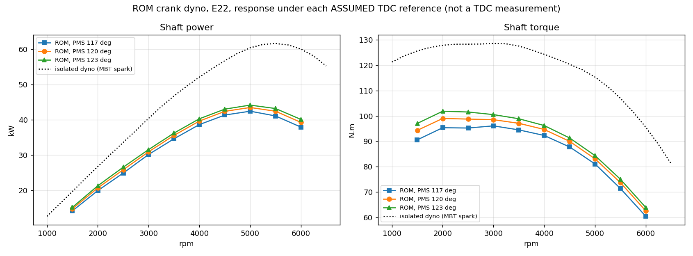

# Dinamômetro físico e bancada com a ROM MA1.7

Escrito com ajuda de LLM (Claude). Goal: `.work/GOAL_DYNO_ROM.md`. Artefatos em `docs/dyno/`.

## Fase 0 — linha de base

* Suíte completa no commit `26bae1d`: **505/505** (native_lab, `ctest -j6`).
* `sevel-dyno` ganhou `--dt-us` (padrão 100) e `--tdc-reference-deg` (padrão 120).
* `tools/dyno_convergence.py` → `docs/dyno/baseline/convergence.csv` + `manifest.json`
  (E22, leak 9 mm², 40 ciclos, dt 100/25/10/1 µs × MBT/30°/36°, 3000–6000 RPM).
  Verificação cruzada: MBT a 6000 RPM = 61,90 kW (100 µs) e 59,09 kW (1 µs), como no goal.

### Variante da ROM e combustível (0.4)

* Os testes de lenta (`PhysicalIdle.*`, `test_idle_acceptance.py`) e o Lab usam
  `FiatTipo_MA17_dump_27c256.bin`, SHA-256 `a34734350611cf561eb39ac1a63097defcaaff642cd7780526f632dda40f8e1f`
  (CMake passa `${PROJECT_SOURCE_DIR}/FiatTipo_MA17_dump_27c256.bin`).
* Em `MA17_FIRMWARE_VARIANTS_ANALYSIS.md` essa imagem é **G (gasolina)**; as imagens de álcool são A, A+, S88, S37, S36.
  O texto "IE ÁLCOOL" de `SEVEL_PHYSICS_CALIBRATION.md` estava errado e foi corrigido.
* Combustível para as Fases 5 e 6: **E22** (gasolina brasileira da época; mesmo do dyno isolado). O emulador
  usa E0 por padrão (`--ethanol-percent 0`); os cenários de dyno com a ROM fixam E22 explicitamente.
* Limitação: `FuelBlend` não modela a água do etanol hidratado. Só importaria se uma ROM de álcool (A/S*) fosse usada.

## Método

* **Integração exata (Fase 1).** O pulso de torque de cada combustão vale `T` entre a centelha e `centelha + 2 rad`.
  O trabalho de um passo é `T · |[θ0, θ1] ∩ pulso|` (`Combustion::work_j`), não a amostra de `T` no início do passo.
  A amostragem pontual creditava energia fora do pulso: com dt = 100 µs o desvio era de +3 a +6 % acima de 4000 RPM.
* **Telemetria de eixo e balanço de energia (Fase 3).** `PlantWindow` contabiliza por janela o trabalho indicado, de atrito,
  de bombeamento, dos acessórios, do freio externo, do arranque e do trem de força, mais ω inicial/final e J. Campos:
  `shaft_torque_nm = indicado − atrito − bombeamento − acessórios`, `brake_absorbed_nm = W_freio/Δθ`,
  `kinetic_j = ½J(ω_fim² − ω_ini²)`, `shaft_power_kw = (W_freio + ΔE_cin − W_arranque − W_trem)/Δt`,
  `energy_residual_rel = (W_ind + W_arr + W_trem − W_atr − W_bomb − W_acess − W_freio − ΔE_cin)/W_ind`.
  O antigo `brake_torque_nm` (= T_i − T_f − T_p − T_carga ≈ J·dω/dt) virou `net_torque_nm`; o critério de lenta
  "torque ao freio ≈ 0" era tautológico e foi trocado por `|resíduo| < 0,5 %` e `|P_eixo| < 0,3 kW`.
* **Limites de controle (Fase 4).** `engine/ControlLimits.hpp`: curso máximo do pedal = folga + r·θ_max (40,27 mm, 90°
  na borboleta) e freio máximo = `DynoPi::t_max` (400 N·m). Lab, controles agendados, replay e CLI usam a mesma fonte.
  O cenário de dyno é explícito (`--dyno-scenario`: E22, vazamento 9 mm², acessórios, líquido 90 °C, PMS 120°);
  `--load-nm` não altera nada disso.
* **Bancada (Fase 5).** `--dyno-point RPM --dyno-cycles N`. Um freio `DynoPi` (ganhos padrão) segura a rotação enquanto
  a ROM comanda injeção e ignição. O controlador lê a velocidade do virabrequim média sobre um intervalo de ignição
  (180°) e mantida até o seguinte; **não** usa RAM47, que a ECU quantiza (±25 RPM) e filtra. Máquina de estados por ticks:
  CRANK → IDLE_SETTLE (12 M ticks, freio desligado) → RAMP (200000 ticks = 0,202 s, pedal a fundo) →
  STABILIZE (velocidade filtrada em ±2 % por 1 s) → MEASURE (40 ciclos) → ACCEPTED / INVALID
  (timeout, brake_saturated, rpm_out_of_band, fuel_cut, rev_limiter, stall, diagnostic_fault, not_steady, energy_residual).
  Aceite: rotação média ±1 %, freio sem saturar, |ΔE_cin|/W_freio < 1 %, |resíduo| < 0,5 %.
* **Identificação.** O binário imprime a linha de medição; `tools/dyno_point.py` acrescenta SHA do código, SHA-256 da ROM,
  argumentos e cenário. No sandbox do native_lab o `.git` não é visível: o SHA vem de `DYNO_CODE_SHA`/`DYNO_CODE_DIRTY`.

## Convergência em dt (Fase 1)

Dyno isolado, E22, vazamento 9 mm², 40 ciclos; erro da potência com dt = 100 µs contra a referência de 1 µs.

<!-- BEGIN:CONV -->
| Modo | RPM | dt=100 µs antes (kW) | erro vs 1 µs antes | dt=100 µs depois (kW) | erro vs 1 µs depois |
|---|---|---|---|---|---|
| MBT | 3000 | 40.98 | +2.42 % | 40.41 | +0.00 % |
| MBT | 4000 | 51.47 | +0.61 % | 52.10 | +0.00 % |
| MBT | 5000 | 60.94 | +2.54 % | 60.41 | +0.00 % |
| MBT | 6000 | 61.90 | +4.76 % | 60.07 | +0.00 % |
| fixed30 | 3000 | 40.87 | +2.41 % | 40.30 | +0.00 % |
| fixed30 | 4000 | 52.73 | +3.11 % | 52.08 | +0.00 % |
| fixed30 | 5000 | 62.46 | +5.81 % | 60.02 | +0.00 % |
| fixed30 | 6000 | 60.77 | +4.74 % | 58.95 | +0.00 % |
| fixed36 | 3000 | 39.76 | +2.45 % | 39.20 | +0.00 % |
| fixed36 | 4000 | 50.90 | +0.61 % | 51.53 | +0.00 % |
| fixed36 | 5000 | 62.73 | +5.80 % | 60.30 | +0.00 % |
| fixed36 | 6000 | 61.90 | +4.77 % | 60.07 | +0.00 % |

Maior |erro| de dt=100 µs contra 1 µs: **5.81 %** antes, **0.00 %** depois.
<!-- END:CONV -->

## Refit da VE (Fase 2) — isto é um ajuste, não uma validação

A VE do motor é desconhecida. Reajustar todos os parâmetros trocava 2 ou 3 testes caóticos da ROM a cada tentativa
(RPM quantizado, filtros e ciclos-limite reagem a mudanças de 1e-4 na VE). Por isso a curva base ficou **bit-idêntica**
e só um parâmetro, `hs_gain` (rampa suave de 2500 a 3500 RPM), foi ajustado com `tools/fit_dyno_ve.py` sobre a integração exata.

<!-- BEGIN:VEFIT -->
* Parâmetro ajustado: `hs_gain` 0.00000 → **0.01941** (rampa 2500→3500 RPM); custo final 0.0267. VE is unknown: this is a fit to the targets, not a validation.

| RPM | torque (N·m) | alvo (N·m) | desvio |
|---|---|---|---|
| 1500 | 125.7 | 115 | +9.3 % |
| 2000 | 127.9 | 126 | +1.5 % |
| 2500 | 128.3 | 134 | -4.2 % |
| 3000 | 128.6 | 133 | -3.3 % |
| 3500 | 127.6 | 132 | -3.3 % |
| 4000 | 124.4 | 126 | -1.3 % |
| 4500 | 120.4 | 117 | +2.9 % |
| 5000 | 115.4 | 109 | +5.8 % |
| 5500 | 107.0 | 102 | +4.9 % |
| 6000 | 95.6 | 96.3 | -0.7 % |
| 6500 | 81.2 | 84 | -3.4 % |

| Etanol | Pico de potência | Pico de torque | Erro de forma máx. 2000–6000 |
|---|---|---|---|
| E22 | 61.64 kW (83.8 cv) a 5500 RPM | 128.62 N·m a 3000 RPM | 8.2 % |
| E0 | 61.70 kW (83.9 cv) a 5500 RPM | 128.74 N·m a 3000 RPM | 8.1 % |
<!-- END:VEFIT -->

## Balanço de energia em marcha lenta livre (Fase 3)

`PhysicalEnergy.RomIdleLedger` e `test_idle_acceptance.py`: resíduo de energia ≈ 5e-13 e potência de eixo ≈ 0,00 kW
(janelas de 20 ciclos, lenta quente, sem freio). Os testes sem ROM (`PlantEnergy.*`) fecham o balanço a < 1e-3 com torque
constante e freio, e `P_eixo = ΔE_cin/Δt` na aceleração livre.

## Ponto 3000 RPM, plena carga, ROM controlando (Fase 5)

<!-- BEGIN:POINT -->
| Grandeza | Valor |
|---|---|
| estado | ACCEPTED |
| rotação média (RPM) | 2999.79 |
| janela (s) | 1.60011 |
| freio médio (N·m) | 98.765 |
| freio de pico (N·m) | 101.277 |
| tempo saturado (s) | 0 |
| potência no eixo (kW) | 30.9508 |
| torque no eixo (N·m) | 98.527 |
| |ΔE_cin|/W_freio | 0.00245 |
| resíduo de energia | -2.992e-13 |
| avanço médio (°) | 18.558 |
| avanço mín (°) | 18.26 |
| avanço máx (°) | 18.66 |
| desvio do avanço (°) | 0.15 |
| λ | 1.006 |
| RAM[69h] bruto (fim) | 128 |
| largura do pulso (ms) | 4.6244 |
| frequência dos pulsos (Hz) | 99.993 |
| duty do bico | 0.46241 |
| centelhas na janela | 160 |

Código `b09207d412`, ROM SHA-256 `a34734350611cf56…`.
<!-- END:POINT -->

Duas execuções são idênticas (`DynoBench.RomPoint3000`).

## Varredura 1500–6000 RPM sob três referências de PMS (Fase 6)

Só o PMS assumido muda entre as três varreduras (117°, 120°, 123°); combustível, vazamento, acessórios, temperaturas e ROM
são idênticos. O resultado é **a resposta de ROM + planta sob cada referência assumida**: a maior potência **não** determina
o PMS físico (a ROM só enxerga o ângulo relativo ao dente, e a planta apenas converte o avanço resultante em eficiência).
O ponto de 6000 RPM é ACCEPTED nas três: a ROM não corta combustível nem limita rotação até 6000 RPM neste cenário.

<!-- BEGIN:SWEEP -->
| TDC ref | rpm | state | spark abs (deg, mod 180) | advance vs ref (deg) | power (kW) | torque (N.m) | lambda | RAM[69h] raw |
|---|---|---|---|---|---|---|---|---|
| 117 | 1499 | ACCEPTED | 112.87 | 4.13 | 14.22 | 90.6 | 1.000 | 159-160 (end 159) |
| 117 | 2001 | ACCEPTED | 109.00 | 8.00 | 19.98 | 95.4 | 0.996 | 148-149 (end 148) |
| 117 | 2503 | ACCEPTED | 106.20 | 10.80 | 24.96 | 95.2 | 0.996 | 140-141 (end 140) |
| 117 | 3000 | ACCEPTED | 101.39 | 15.61 | 30.19 | 96.1 | 1.005 | 127-128 (end 128) |
| 117 | 3500 | ACCEPTED | 98.93 | 18.07 | 34.64 | 94.5 | 1.000 | 120-120 (end 120) |
| 117 | 4000 | ACCEPTED | 96.26 | 20.74 | 38.66 | 92.3 | 1.000 | 112-113 (end 112) |
| 117 | 4504 | ACCEPTED | 94.42 | 22.58 | 41.38 | 87.7 | 1.000 | 107-108 (end 107) |
| 117 | 5003 | ACCEPTED | 92.92 | 24.08 | 42.46 | 81.0 | 0.999 | 103-104 (end 103) |
| 117 | 5502 | ACCEPTED | 92.05 | 24.95 | 41.12 | 71.4 | 0.997 | 101-102 (end 101) |
| 117 | 6003 | ACCEPTED | 90.64 | 26.36 | 37.95 | 60.4 | 0.996 | 96-97 (end 96) |
| 120 | 1499 | ACCEPTED | 112.88 | 7.12 | 14.81 | 94.3 | 1.000 | 159-160 (end 159) |
| 120 | 2001 | ACCEPTED | 109.00 | 11.00 | 20.75 | 99.0 | 0.996 | 148-149 (end 148) |
| 120 | 2503 | ACCEPTED | 106.20 | 13.80 | 25.88 | 98.8 | 0.996 | 140-141 (end 140) |
| 120 | 3000 | ACCEPTED | 101.44 | 18.56 | 30.95 | 98.5 | 1.006 | 127-128 (end 128) |
| 120 | 3500 | ACCEPTED | 98.93 | 21.07 | 35.59 | 97.1 | 0.999 | 120-120 (end 120) |
| 120 | 4000 | ACCEPTED | 96.26 | 23.74 | 39.66 | 94.7 | 1.000 | 112-113 (end 112) |
| 120 | 4504 | ACCEPTED | 94.42 | 25.58 | 42.42 | 89.9 | 1.000 | 107-108 (end 107) |
| 120 | 5003 | ACCEPTED | 92.93 | 27.07 | 43.51 | 83.1 | 0.999 | 103-104 (end 104) |
| 120 | 5502 | ACCEPTED | 92.06 | 27.94 | 42.45 | 73.7 | 0.997 | 101-102 (end 101) |
| 120 | 6003 | ACCEPTED | 90.65 | 29.35 | 39.29 | 62.5 | 0.996 | 96-97 (end 96) |
| 123 | 1499 | ACCEPTED | 112.91 | 10.09 | 15.24 | 97.0 | 1.000 | 159-160 (end 159) |
| 123 | 2001 | ACCEPTED | 109.00 | 14.00 | 21.35 | 101.9 | 0.996 | 148-149 (end 148) |
| 123 | 2502 | ACCEPTED | 106.20 | 16.80 | 26.61 | 101.6 | 0.996 | 140-141 (end 140) |
| 123 | 3000 | ACCEPTED | 101.43 | 21.57 | 31.58 | 100.5 | 1.006 | 127-128 (end 128) |
| 123 | 3500 | ACCEPTED | 98.93 | 24.07 | 36.25 | 98.9 | 0.999 | 120-120 (end 120) |
| 123 | 4000 | ACCEPTED | 96.27 | 26.73 | 40.31 | 96.2 | 1.000 | 112-113 (end 112) |
| 123 | 4504 | ACCEPTED | 94.44 | 28.56 | 43.05 | 91.3 | 1.000 | 107-108 (end 107) |
| 123 | 5002 | ACCEPTED | 92.96 | 30.04 | 44.19 | 84.4 | 0.999 | 103-104 (end 104) |
| 123 | 5501 | ACCEPTED | 92.04 | 30.96 | 43.22 | 75.0 | 0.998 | 101-101 (end 101) |
| 123 | 6002 | ACCEPTED | 90.66 | 32.34 | 40.13 | 63.8 | 0.996 | 97-97 (end 97) |

* PMS 117°: 10/10 pontos ACCEPTED; pico de potência 42.46 kW a 5003 RPM; pico de torque 96.1 N·m a 3000 RPM.
* PMS 120°: 10/10 pontos ACCEPTED; pico de potência 43.51 kW a 5003 RPM; pico de torque 99.0 N·m a 2001 RPM.
* PMS 123°: 10/10 pontos ACCEPTED; pico de potência 44.19 kW a 5002 RPM; pico de torque 101.9 N·m a 2001 RPM.
<!-- END:SWEEP -->

### ROM contra dyno isolado (PMS 120°)

O dyno isolado usa o avanço MBT da planta e não tem acessórios; a ROM usa o próprio avanço, e a planta aplica
`f_av = 1 − 3,5e-4·Δ²` pela distância ao MBT.

<!-- BEGIN:GAP -->
| RPM | indicado ROM (N·m) | indicado isolado (N·m) | avanço ROM (°) | MBT isolado (°) | acessórios ROM (N·m) | eixo ROM (N·m) | freio isolado (N·m) |
|---|---|---|---|---|---|---|---|
| 1500 | 112.9 | 141.6 | 7.1 | 20.6 | 2.8 | 94.3 | 125.7 |
| 2000 | 119.6 | 145.1 | 11.0 | 23.2 | 3.4 | 99.0 | 127.9 |
| 2500 | 121.8 | 147.0 | 13.8 | 25.4 | 4.5 | 98.8 | 128.3 |
| 3000 | 124.4 | 148.7 | 18.6 | 27.4 | 6.0 | 98.5 | 128.6 |
| 3500 | 126.3 | 149.2 | 21.1 | 29.2 | 7.8 | 97.1 | 127.6 |
| 4000 | 127.5 | 147.6 | 23.7 | 30.9 | 9.9 | 94.7 | 124.4 |
| 4500 | 126.9 | 145.3 | 25.6 | 32.4 | 12.3 | 89.9 | 120.4 |
| 5000 | 124.3 | 141.8 | 27.1 | 33.9 | 15.0 | 83.1 | 115.4 |
| 5500 | 119.4 | 134.9 | 27.9 | 35.2 | 18.1 | 73.7 | 107.0 |
| 6000 | 112.7 | 124.6 | 29.3 | 36.4 | 21.4 | 62.5 | 95.6 |
<!-- END:GAP -->

O torque no eixo da ROM fica bem abaixo do dyno isolado. O avanço da ROM está 7–13° abaixo do MBT assumido, o que explica só
parte do déficit de torque indicado; o resto não foi decomposto (ver backlog).

## § Bloqueios

### B1 — Fase 2: erro de forma da curva acima da banda (critério BLOQUEADO)

* **Critério:** forma da curva de potência dentro de ±8 % da CEE × 1,1 entre 2000 e 6000 RPM.
* **Evidência:** `docs/dyno/fase2/dyno_summary.csv`: erro máximo 8,2 % (E22) e 8,1 % (E0). Torque a 3000 RPM −3,3 % do alvo de 133 N·m
  (`fit_result.json`). Os outros alvos (pico de potência 61,64 kW, 5500 RPM; 60,06 kW a 6000) estão na banda.
* **Reprodução:** `python3 tools/dyno_acceptance.py build-lab/sevel-dyno docs/dyno/fase2`.
* **Hipótese:** o ajuste foi restrito a um parâmetro (`hs_gain`) para não perturbar os testes caóticos da ROM abaixo de
  2500 RPM; a curva base (inalterada) não acompanha a forma alvo ali. Um refit livre foi tentado e flipou 2–3 testes
  por tentativa. Não relaxei a banda nem ajustei parâmetros para forçar o número.
* **Efeito:** as demais fases não dependem da banda e foram executadas; a Fase 2 fica **BLOQUEADA** neste critério (o refit entregue é o melhor obtido sem perturbar a suíte).

### Proveniência dos manifestos

Todos os manifestos trazem o SHA real (`DYNO_CODE_SHA`, pois o sandbox não lê o `.git`). O baseline da Fase 0 foi
**regenerado** com o binário antigo reconstruído num worktree do commit `efa374f` (integração por amostra); as
Fases 1–2 no commit `f5ff2b6`; as Fases 5–6 em `b09207d`.

## Estado das fases

| Fase | Estado | Commit |
|---|---|---|
| 0 Linha de base | ACEITA | `efa374f` |
| 1 Integração exata | ACEITA | `7f4a478` |
| 2 Refit da VE | BLOQUEADA (B1: forma 8,2 % > 8 %; demais alvos atendidos) | `48bd7ab` |
| 3 Telemetria de eixo e balanço | ACEITA | `91a854e` |
| 4 Limites de controle e cenário | ACEITA | `c4e292b` |
| 5 Bancada com a ROM (3000 RPM) | ACEITA | `8e437df` |
| 6 Varredura × PMS | ACEITA | `b09207d` |
| 7 Documentação | ver `git log` | — |

## Limitações

* A VE é um ajuste a alvos aproximados (torque 133 N·m a 3000 RPM, potência de 60,3 kW a ~5750–6000 RPM); a forma da curva
  tem erro máximo de ~8 % entre 2000 e 6000 RPM.
* A planta de acessórios (alternador + bomba) é pesada em alta rotação (21 N·m a 6000 RPM) e não foi validada.
* O sensor VR e o PMS físico são desconhecidos; as três varreduras são hipóteses, não medições.
* O formato do pulso de combustão é retangular (2 rad); não há Wiebe nem biela-manivela.
* Lenta de 850 RPM: indicativa, fora do escopo.
* O freio do dyno usa a velocidade média de 180° e os ganhos padrão do `DynoPi`; ganhos diferentes não foram explorados.
* `FuelBlend` não modela a água do etanol hidratado.
* Manifestos: ver § Bloqueios (proveniência).

## Backlog (registrado, não feito)

* Decompor a diferença de torque indicado entre a ROM e o dyno isolado (penalidade de avanço, ar admitido, queima).
* Pressão no cilindro por Wiebe + biela-manivela; atrito Chen–Flynn; filme/evaporação; atraso do sensor VR;
  cadeia N/K da RAM[69h] → Timer 1; painel Torque/Potência na GUI; dyno com transmissão e rodas.
* Ligar o `DynoPi` ao `SimSession`/Lab (hoje só o CLI headless tem a bancada).
