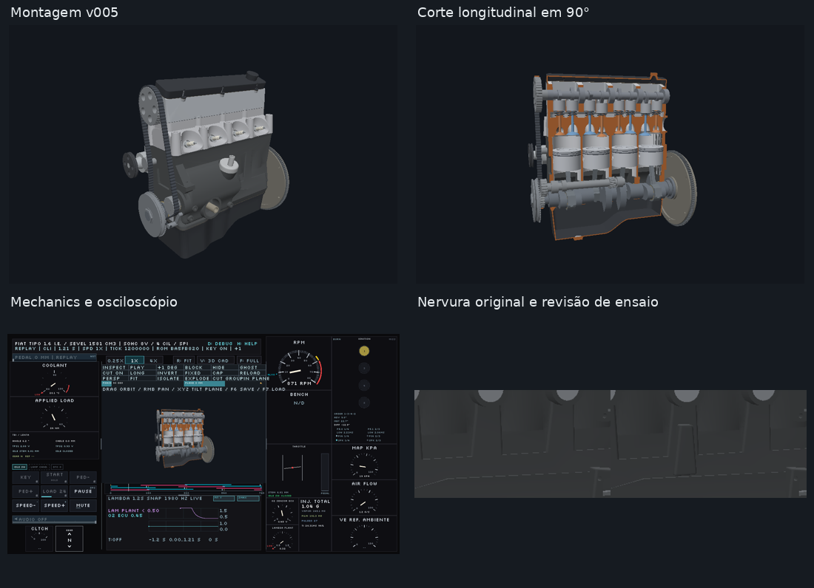

# Aceite do motor CAD no MA1.7 Lab

## Resultado da montagem

A v005 dos coletores é a montagem de referência. O painel Mechanics e a janela independente apresentam 224 instâncias e 105 geometrias compartilhadas. O Lab abre o pacote instalado em Linux x86-64 sem o FreeCAD. O checkpoint v002 continua carregável. A revisão de ensaio da nervura está disponível separadamente.



| Marco | Verificação |
|---|---|
| M0 · Referenciais | Duas instâncias assimétricas com pivô deslocado e cores distintas. Nas vistas frontal e traseira, as extremidades projetadas ficaram a menos de 2 pixels das caixas de referência do FreeCAD. O roundtrip STEP da v005 preservou os 224 sólidos com erro relativo de volume de 4,75 × 10⁻⁷ |
| M1 · Carregamento | SHA-256, caminhos, índices, normais, fechamento, orientação, unidades, materiais, IDs e transformações verificados. Casos negativos cobrem corrupção, symlinks, escala, eixo e datum. Acréscimo e remoção de peças compatíveis passaram |
| M2 · Renderização | Perspectiva e ortográfica, profundidade, iluminação, descarte de faces traseiras, teste do volume visível e transparência. A área 3D do painel usa textura e depth próprios. A leitura de volta à CPU ocorre nas capturas |
| M3 · Animação | 224 peças em −90°, 0°, 90°, 180°, 270°, 359°, 360°, 540°, 719° e 720°. Comparação com quatro poses exportadas do FreeCAD e com o mecanismo paramétrico nas demais fases. Tolerâncias de software de 4 × 10⁻⁶ nas matrizes e 10⁻⁷ m nas juntas e levantes |
| M4 · Cortes | Máscaras de pixels verificadas em cubo, cilindro, tubo, seção côncava e partes que se tocam. Passaram planos longitudinais, transversais, horizontais, oblíquos, invertidos, tangentes, externos e dois semiespaços simultâneos. Um pistão de ensaio deixou de intersectar o plano superior em PMI e passou a intersectar o inferior |
| M5 · Interface | Mecânica tradicional e CAD selecionáveis, LIVE e INSPECT separados, controle de câmera e plano, grupos, ghost, isolamento, presets e evidência da peça. Raycast testado com sólido interno, superfície externa, semiespaço descartado, cap e segundo plano |
| M6 · Reexportação | A mesma compilação carregou as duas revisões. F5 ativou a modificada em movimento, rejeitou um OBJ corrompido e uma revisão ausente e voltou à referência com a mesma sessão |
| M7 · Reprodução | Galeria da montagem, cinco fases de corte, vistas oblíqua e transversal, ghost, painel integrado, teste de nervura e logs por captura. O diretório local de evidências é `build/sevel-cad/acceptance/` |

## Comparação da nervura

A cópia de ensaio prolonga a nervura central do bloco. O ganho de volume no CAD foi de aproximadamente 13,8 cm³. É uma variação estética de teste. As proporções de produção continuam dependendo de fotografias e de medições da peça. Para as decisões sobre a montagem real, consulte as revisões das [velas](../cad/sevel16/VISUAL_REVIEW_SPARK_BCPR5ES.md), do [bloco e bocal da PCV](../cad/sevel16/VISUAL_REVIEW_BLOCK_PCV.md) e dos [coletores](../cad/sevel16/VISUAL_REVIEW_MANIFOLDS_V005.md).

| Artefato | Identificador SHA-256 |
|---|---|
| Manifest v005 ativo | `294b11f14e15c5951e9a4fc5e0c16f32ee6e3af9c55d38ae5b4f40058e0ff2ac` |
| Manifest do ensaio | `63854f4581754d7eb8cb3bd427f2d7ea5870e876556bacf0b99afab7be5f2962` |
| Poses das duas revisões no tick 1.200.000 | `b253fe411c53fedad1e3d9cf28fcbf5b5246edbd6a45684f8a5eec9458650690` |

Somente `sevel.block` mudou de `mesh_id`. Com os presets idênticos, 585 pixels do detalhe lateral mudaram em mais de três níveis por canal na captura de 960 × 640. As dez listagens de matrizes e deformações coincidiram byte por byte, inclusive para pistões, comando, molas e correia. A fase LIVE atingiu 5124,492599693° e o replay da ROM registrou 871,174682 rpm, 27 pulsos CC3, 25 combustões e 157 eventos, com `state=702476ee302525da` e `event_hash=af1ad8d7a7987631`.

## Medição gráfica

SDL 3.2.8, Vulkan RADV, Radeon RX 7900 XTX, cena de 960 × 640. Cada linha usa 58 frames depois de dois frames de aquecimento. A opção `SEVEL_CAD_PROFILE=1` mede do início do desenho à conclusão na GPU, incluindo submissão pela CPU. A coluna de FPS inclui também instrumentos, apresentação e o atraso de 1 ms do Lab. São amostras desta máquina.

| Cena | Draws | Triângulos submetidos | Caps | Desenho com espera GPU | FPS do Lab |
|---|---:|---:|---:|---:|---:|
| Montagem parada | 266 | 1.359.482 | 0 | 0,91 ms | 44,1 |
| LIVE com ROM | 266 | 1.359.482 | 0 | 0,94 ms | 41,3 |
| Longitudinal preenchido | 378 | 1.559.792 | 59 | 2,02 ms | 38,6 |
| Vista superior com ghost, coletores e acessórios ocultos | 199 | 1.163.438 | 0 | 0,84 ms | 44,0 |

Na captura do painel, a referência levou cerca de 0,70 s para abrir e 11 ms para instalar a geometria. Os dois buffers estáticos somam 33.409.080 bytes, incluindo o quadrilátero reutilizado pelo stencil. As arenas contêm 685.638 vértices e 997.260 triângulos incluindo esse quadrilátero. A contagem submetida por frame também inclui as instâncias compartilhadas e os passes de seção. A memória das texturas, do driver e dos dados CPU fica fora dessa medição.

## Reproduzir os ensaios

Forneça ao CMake `SEVEL_CAD_TEST_EXPORT`, `SEVEL_CAD_TEST_PARAMETERS` e `SEVEL_CAD_TEST_DATUM` para incluir as provas da montagem local além dos testes sintéticos. Os testes gráficos Python usam Pillow. Esta revisão executou as provas gráficas, offscreen e de ptrace via Native Lab MCP.

```sh
ctest --test-dir build-lab -R '^SevelCad\.' --output-on-failure
REG=build/sevel-cad/runtime-assets
BASE="$REG/294b11f14e15c5951e9a4fc5e0c16f32ee6e3af9c55d38ae5b4f40058e0ff2ac"
TRIAL="$REG/63854f4581754d7eb8cb3bd427f2d7ea5870e876556bacf0b99afab7be5f2962"
OUT=build/sevel-cad/acceptance
python3 tests/test_cad_engine_gallery.py build-lab/sevel-ma17-lab "$ROM" "$BASE" "$TRIAL" "$OUT" \
  --overview docs/media/sevel-cad-3d.png
VK_DRIVER_FILES=/usr/share/vulkan/icd.d/lvp_icd.json xvfb-run -a \
  python3 tests/test_cad_reload.py build-lab/sevel-ma17-lab "$ROM" "$BASE" "$TRIAL" "$OUT/reload.log"
```

O teste de F5 usa lavapipe para apresentar no Xvfb desta máquina. A galeria e as medições usaram a Radeon. O gerador offline `tools/build_sevel_cad_shaders.py` recompilou os seis artefatos idênticos aos versionados. SPIR-V foi executado em Vulkan. DXIL e MSL foram gerados e comparados em disco. D3D12 e Metal ainda requerem ensaio em seus sistemas nativos.

O recorte é uma operação visual sobre o sólido triangulado. A correia usa um padrão periódico com o passo do rig. O perfil de came é sintético e a malha da mola é deformada com pesos ao longo da hélice. A bomba d'água permanece estática enquanto sua relação de transmissão estiver indeterminada. O datum e as dimensões aproximadas do cabeçote, das nervuras e dos coletores continuam classificados como provisórios.

## Regressão da ECU e do Lab

O primeiro CTest completo executou os 635 testes registrados naquele build. Nove falharam. Corrigimos a descoberta da janela X11 durante o fallback, a faixa de preferências para a quinta vista e o registro imediato do congelamento da curva WOT. A verificação final passou em **17/17**, incluindo os cinco testes CAD, os quatro casos de interface antes reprovados, Vulkan offscreen, áudio e ptrace.

Considerando o último resultado de cada teste nas rodadas, **632 dos 637 casos registrados passaram**. As cinco falhas restantes ocorreram também no executável da ECU recompilado a partir de `50b8fae`, com a mesma ROM e as mesmas entradas.

| Teste herdado | Divergência reproduzida na linha de base |
|---|---|
| PhysicalEngine.SustainedSixtySeconds | Médias de 860,36 e 888,37 rpm para os dois passos de fluido, acima da diferença permitida de 25 rpm |
| PhysicalIdle.CandidateP15P16 | O diagnóstico F84E permanece em zero no caso de TPS aberto |
| PhysicalIdle.ContactClosedDuringPedal | O intervalo entre armar e limpar excede o limite do teste |
| PhysicalIntake.ConditionalCc3Fuel | As primeiras bordas comparadas ocorrem em ticks diferentes |
| PhysicalLambda.PumpRelayHeaterCandidate | O primeiro tick de acionamento excede a janela exigida |

Os controles do dinamômetro produziram 116,7 Nm a 3000 rpm e 115,6 Nm a 3500 rpm nas duas compilações, com os dois pontos aceitos e a curva congelada. A suíte completa está em `build-lab/cad-regression.log`. O recorte final está em `build/sevel-cad/acceptance/final-ctest.log`, junto das comparações com a linha de base.

A instalação foi iniciada sob `strace` a partir de um diretório temporário com a ROM fornecida à parte. O processo leu o ponteiro e os OBJ em `bin/assets/sevel-cad` e capturou o painel no tick 50.000. O rastreamento em `portable-open.log` confirma a independência dos diretórios de exportação, modelos e fotografias.
